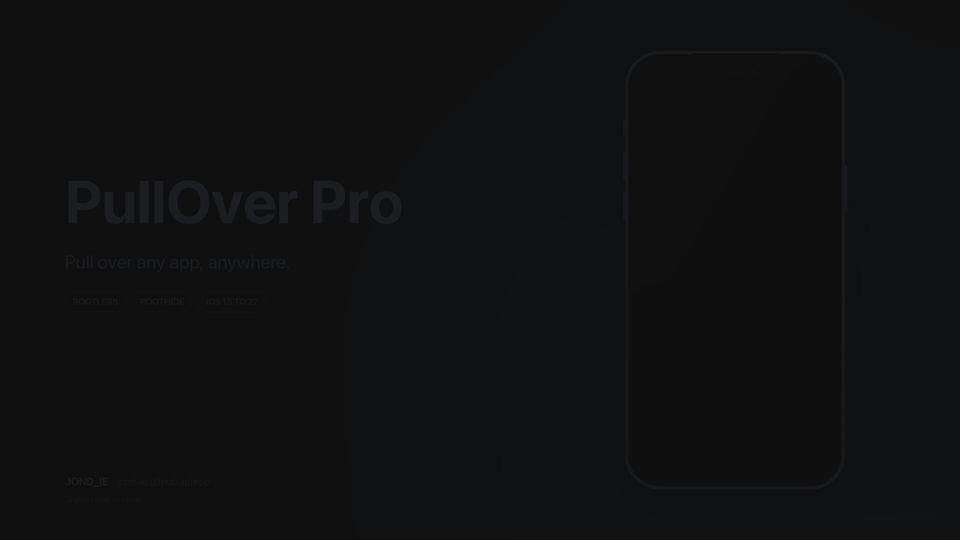
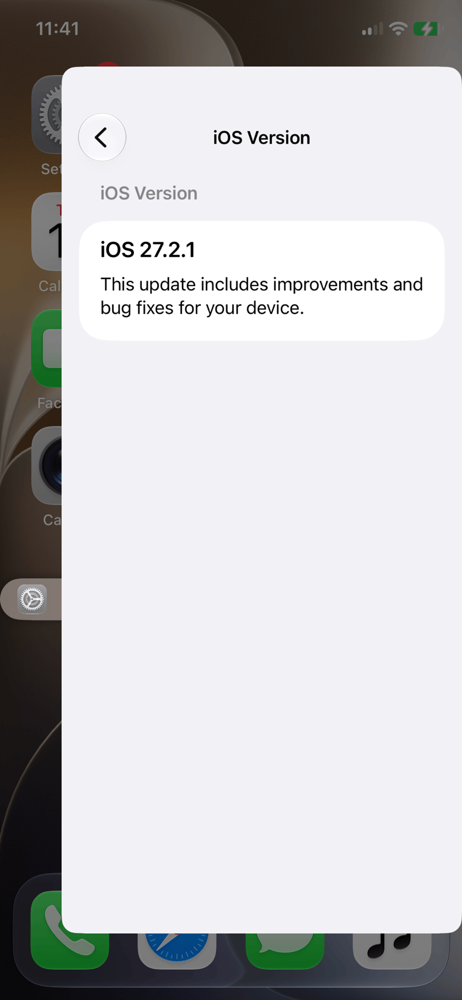
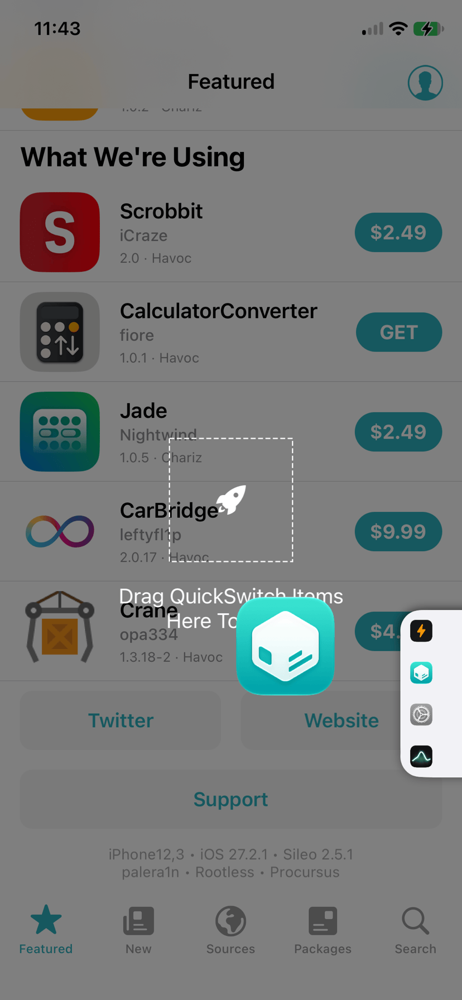
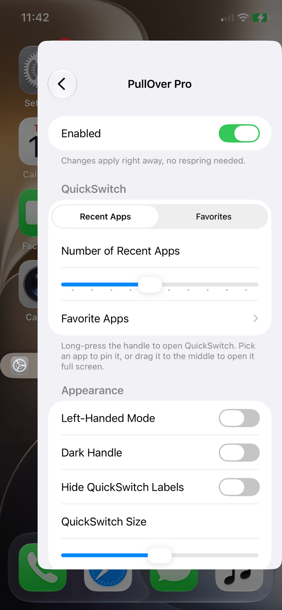

# PullOver Pro

Pull over any app, anywhere.



- **Pull the handle** at the edge of the screen and your app slides in over the one you are using, still live. Push it back to tuck it away.
- **QuickSwitch:** long-press the handle to pick from your recent apps or favorites. Tap one to pull it over, or drag it to the middle to open it full screen.
- **Settings** apply right away, no respring.

<p>



</p>

Get it from the [Jond_ie repo](https://jond-ie.github.io/repo/), or from [Releases](https://github.com/Jond-ie/pulloverpro/releases). Rootless and RootHide jailbreaks, iOS 15 to 27. What changed in each version: [CHANGELOG.md](CHANGELOG.md).

## Building

Theos, Rootless scheme:

```
make package THEOS_PACKAGE_SCHEME=rootless
```

For native RootHide, use the RootHide fork of Theos with its vendor submodules:

```sh
make clean THEOS_PACKAGE_SCHEME=roothide
make package THEOS_PACKAGE_SCHEME=roothide FINALPACKAGE=1 DEBUG=0
```

The local optimized build uses `jbroot()` under the RootHide scheme. If the selected SDK does not ship the private Preferences framework linker stub, supply its compatible framework directory via `ADDITIONAL_LDFLAGS="-F/path/to/frameworks"`. The linker stub is only a build dependency.

Landscape is enabled by default for fresh settings. The optional **Landscape Touch Through** setting permits taps outside the drawer to pass through the overlay window in landscape. When enabled, use the handle to close the drawer. Existing saved Hide in Landscape preferences are respected.

The favorites picker uses [AltList](https://github.com/opa334/AltList) at runtime (package dependency).

<details>
<summary>Credits and licence</summary>

Original tweak by c1d3r ([@c1d3rdev](https://x.com/c1d3rdev), [source](https://github.com/c1d3rdev/PullOver-Pro)), GPL-3.0, with iOS 13 support by [@akusio_RR](https://x.com/akusio_RR). Updated for iOS 15 to 27 by Jond_ie ([@Jond_ie](https://x.com/Jond_ie)), under the same GPL-3.0 licence (see LICENSE).
</details>
