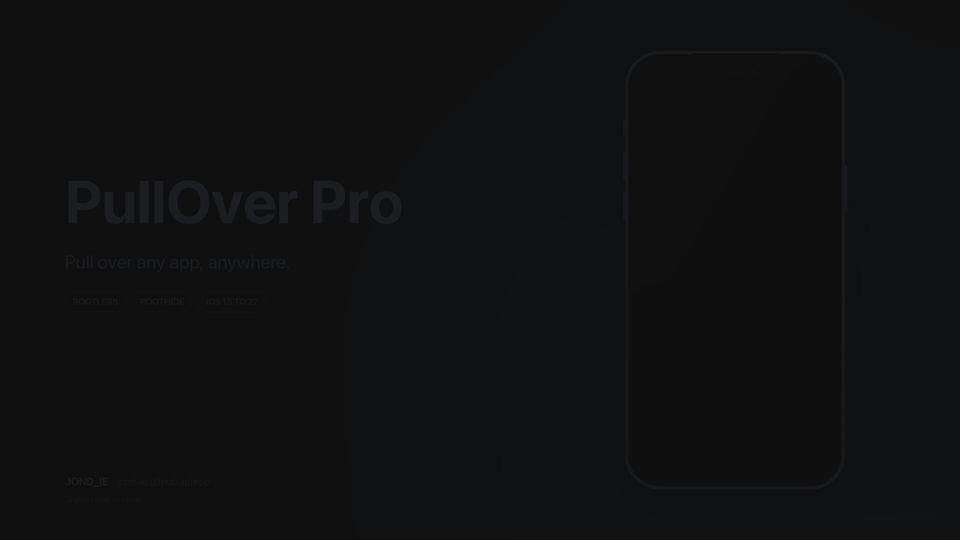
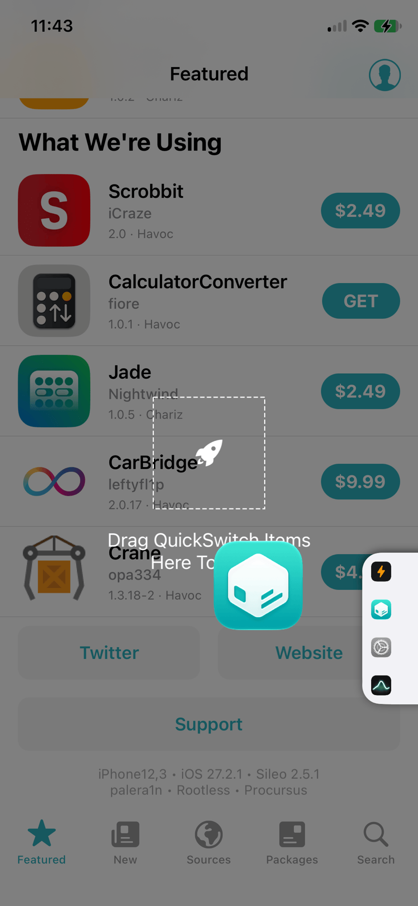
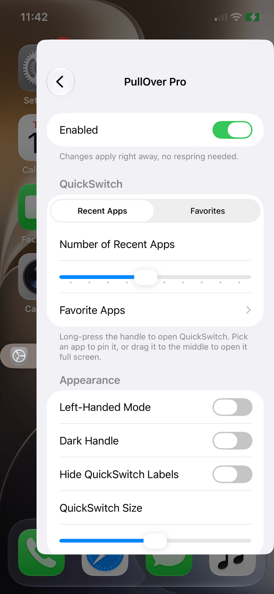

<div align="center">
  

  <h1>PullOver Pro</h1>
  <p><strong>面向越狱 iPhone 的实时应用侧边浮窗插件</strong></p>
  <p>通过屏幕边缘手柄访问常用应用，支持横屏多任务场景。</p>

  <a href="https://github.com/HuYang-s/pulloverpro/releases/tag/v3.0.2-codex3"></a>
  
  
  <a href="LICENSE"></a>

  <p><a href="README.md">English</a> · <strong>简体中文</strong></p>
  <p><a href="#下载安装包">下载</a> · <a href="#主要功能">功能</a> · <a href="#安装与使用">使用</a> · <a href="#源码编译">编译</a> · <a href="CHANGELOG.md">更新日志</a></p>

  
  <p><sub>演示来自上游项目，优化版的具体显示与操作可能有所不同。</sub></p>
</div>

## 项目简介

PullOver Pro 通过 SpringBoard 和 iOS Scene 私有接口，将应用的实时界面托管到侧边抽屉中。用户可以点击或滑动边缘手柄打开固定应用，也可以长按手柄进入 QuickSwitch，快速选择其他应用。

本项目基于 [Jond-ie/pulloverpro](https://github.com/Jond-ie/pulloverpro) 进行优化，重点改善横屏使用体验、应用托管生命周期、手势交互和 RootHide 原生适配。适合在使用其他应用时临时查资料、阅读消息或打开 ChatGPT 等场景。

## 下载安装包

**当前版本：[v3.0.2-codex3](https://github.com/HuYang-s/pulloverpro/releases/tag/v3.0.2-codex3)（预发布版）。**

| 越狱环境 | 软件包架构 | 下载 |
| --- | --- | --- |
| Dopamine RootHide 等兼容 RootHide 环境 | `iphoneos-arm64e` | [**RootHide 原生 DEB**](https://github.com/HuYang-s/pulloverpro/releases/download/v3.0.2-codex3/PullOverPro-3.0.2-codex3-roothide.deb) |
| 普通 Rootless 无根越狱 | `iphoneos-arm64` | [**Rootless DEB**](https://github.com/HuYang-s/pulloverpro/releases/download/v3.0.2-codex3/PullOverPro-3.0.2-codex3-rootless.deb) |

两个安装包内均包含 arm64 和 arm64e 二进制切片，软件包标识均为 `com.johndie.pulloverpro-rootless`。根据越狱环境选择其中一个版本安装即可。

其他发布文件：[完整源码](https://github.com/HuYang-s/pulloverpro/releases/download/v3.0.2-codex3/PullOverPro-3.0.2-codex3-source.zip) · [中文使用说明](https://github.com/HuYang-s/pulloverpro/releases/download/v3.0.2-codex3/INSTALL-ZH.md) · [构建验证报告](https://github.com/HuYang-s/pulloverpro/releases/download/v3.0.2-codex3/BUILD-VALIDATION.txt) · [SHA-256 校验值](https://github.com/HuYang-s/pulloverpro/releases/download/v3.0.2-codex3/SHA256SUMS.txt)。

## 主要功能

| 功能 | 说明 |
| --- | --- |
| 实时应用浮窗 | 通过可移动的边缘手柄访问固定应用。 |
| QuickSwitch 快速切换 | 支持最近应用和收藏应用，也可拖动应用至屏幕中央全屏打开。 |
| 横屏紧凑布局 | 横屏使用较窄的侧栏及较淡的背景遮罩，保留更多底层应用画面。 |
| 横屏触摸穿透 | 可选功能，尝试让浮窗外区域继续接收底层应用的触摸操作。 |
| 个性化设置 | 支持左手模式、深色手柄、触觉反馈、菜单缩放和自动缩小手柄。 |
| 生命周期管理 | 锁屏及部分系统界面切换时清理托管状态，设置修改无需 Respring。 |

<div align="center">
  
  
  
  <p><sub>上游项目截图：实时浮窗、快速切换和设置页面。</sub></p>
</div>

### 3.0.2~codex3 优化内容

- 插件设置、快速切换操作提示及应用加载失败提示统一为简体中文。
- 收起时保留 30 pt 可见宽度，触摸区域名义尺寸扩大至 44 × 52 pt。
- 淡化手柄后保留 55% 不透明度，仍可直接点击或长按唤出浮窗。
- 手柄交互或快速切换期间延后自动收起。

保留上一版本的优化：

- 横屏默认开启，保留用户此前保存的偏好设置。
- 根据屏幕安全区域计算布局，旋转时保留抽屉进度，并减少抽屉与应用内部滑动手势的冲突。
- 增加 Scene、Presenter 有效性检查、有限次数重试和过期异步回调拦截，改进前后台状态恢复。
- 修复 QuickSwitch 列表去重、索引边界、边缘滚动和单元格复用等问题。
- 增加配置校验、设置更新防抖和应用图标缓存。
- 采用 `jbroot()` 实现 RootHide 原生路径解析，并分别构建 RootHide 和 Rootless 版本。

完整历史见 [CHANGELOG.md](CHANGELOG.md)。

## 安装与使用

### 安装步骤

运行环境需要兼容的越狱 iPhone、Substrate 兼容注入层（`mobilesubstrate`）和 [AltList](https://github.com/opa334/AltList)。设置页面还需要 PreferenceLoader。

1. 在 [Release 页面](https://github.com/HuYang-s/pulloverpro/releases/tag/v3.0.2-codex3) 下载对应的 DEB。
2. 使用 Sileo 等兼容包管理器打开，确认依赖正常后安装或升级。
3. 执行 Respring（重启 SpringBoard）。
4. 进入 **设置 → PullOver Pro**，开启“启用插件”。

### 横屏游戏推荐设置

| 设置项 | 推荐配置 |
| --- | --- |
| 启用插件 | 开启插件 |
| 横屏时隐藏插件 | 关闭横屏隐藏 |
| 快速切换 | 选择收藏应用 |
| 收藏应用 | 添加 ChatGPT、京东等常用应用 |
| 横屏触摸穿透 | 初次正常使用后再尝试开启，默认关闭 |
| 闲置时自动收起 | 可选，闲置时缩小手柄 |
| 自动收起延时（秒） | 默认 5 秒 |

点击或向屏幕内拉动手柄打开浮窗，关闭浮窗后长按手柄选择其他应用。开启触摸穿透后，使用手柄关闭浮窗。游戏能否持续运行、双区域触摸是否有效以及键盘能否正常输入，还取决于 iOS 的焦点管理和应用本身。

## 兼容性与验证状态

| 验证项目 | v3.0.2-codex3 状态 |
| --- | --- |
| 软件包声明的系统范围 | iOS 15.0 至低于 28.0 的版本 |
| RootHide、Rootless Release 构建 | 已通过 |
| DEB 内容、二进制架构及 Plist 检查 | 已通过 |
| Mach-O 架构与软件包检查 | 已通过 |
| iPhone 14 Pro、iOS 17.0、RootHide 安装 | 上一版 codex2 已安装；codex3 待安装 |
| 应用浮窗、键盘、游戏触摸穿透 | 待真机功能测试 |
| FPS、内存占用、耗电优化幅度 | 暂无基准测试数据 |

系统范围为软件包的声明目标，实际兼容性仍受私有接口和越狱环境影响。编译及安装成功不代表所有功能已经通过真机验证。

## 源码编译

需要 [Theos](https://theos.dev/)、iPhoneOS SDK、Clang 和 ldid。最低编译部署目标为 iOS 15.0。

```sh
git clone https://github.com/HuYang-s/pulloverpro.git
cd pulloverpro
```

### 普通 Rootless

将 `THEOS` 指向普通 Theos 安装目录：

```sh
make clean THEOS_PACKAGE_SCHEME=rootless
make package THEOS_PACKAGE_SCHEME=rootless FINALPACKAGE=1 DEBUG=0
```

### 原生 RootHide

将 `THEOS` 指向 [RootHide Theos](https://github.com/roothide/theos) 安装目录，并初始化其递归子模块：

```sh
make clean THEOS_PACKAGE_SCHEME=roothide
make package THEOS_PACKAGE_SCHEME=roothide FINALPACKAGE=1 DEBUG=0
```

如果所选 SDK 缺少 Preferences 私有框架的链接描述文件，可在打包命令中增加 `ADDITIONAL_LDFLAGS="-F/path/to/frameworks"`，指定兼容的框架目录。该描述文件仅在构建时使用。

编译完成的 DEB 位于 `packages/`。工具链与构建验证细节见 [构建报告](https://github.com/HuYang-s/pulloverpro/releases/download/v3.0.2-codex3/BUILD-VALIDATION.txt)。

### 项目结构

| 目录或文件 | 作用 |
| --- | --- |
| [Tweak/](Tweak/) | SpringBoard 注入、应用托管、浮窗界面及 QuickSwitch |
| [Prefs/](Prefs/) | 系统设置页面和配置交互 |
| [Shared/](Shared/) | 共享配置标识和越狱路径适配 |
| [layout/](layout/) | 打包资源及 PreferenceLoader 注册 |
| [control](control) | 软件包信息与依赖声明 |

## 常见问题

- **手柄不显示：**解锁手机，确认“启用插件”已开启、横屏隐藏已关闭，必要时重新 Respring。
- **没有设置入口：**检查适配当前越狱环境的 PreferenceLoader 和 AltList。
- **应用无法加载：**关闭浮窗并尝试其他应用，部分应用或系统版本可能不支持当前 Scene 托管方式。
- **游戏操作或键盘异常：**关闭“横屏触摸穿透” 后重新测试。
- **SpringBoard 异常：**使用越狱环境的恢复功能禁用或卸载插件，再重新 Respring。

欢迎贡献代码或提供可复现的测试反馈。反馈时请注明设备型号、iOS 版本、越狱环境、插件版本、复现步骤，并移除崩溃日志中的个人信息。

## 致谢与许可证

本项目遵循 [GPL-3.0 开源许可证](LICENSE)。

- [c1d3r / Will Smillie](https://github.com/c1d3rdev/PullOver-Pro)：原始 PullOver Pro。
- [akusio_RR](https://x.com/akusio_RR)：iOS 13 支持。
- [Jond-ie](https://github.com/Jond-ie/pulloverpro)：现代 iOS 移植及上游维护。
- [HuYang-s](https://github.com/HuYang-s)：本优化分支。
